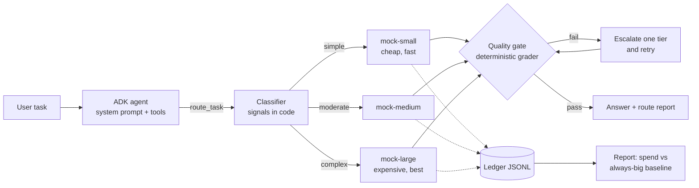

# Agent Model Router

Every request hits your most expensive model. "hi" costs the same as reviewing a 40-page contract. Most agent stacks wire one model to everything because it's the easy default — and then the bill shows up.

This agent routes by **task difficulty** instead: a deterministic classifier sizes up each task, the cheapest model that can plausibly do it gets first shot, a quality gate grades the answer, and failures escalate to a bigger model. Every attempt — passes and failures alike — lands in a cost ledger, so the savings versus an always-big-model baseline are a number, not a feeling.

## How it works



- **Classifier** (`classifier.py`) — difficulty from deterministic signals: task type, input length, keywords, arithmetic shape. No prompt decides anything; every classification carries the signals that produced it.
- **Model pool** (`models.py`) — three tiers with distinct cost/quality profiles. The small model is genuinely worse: it slips on multi-step arithmetic, truncates summaries, and hand-waves analysis. That's the point — routing only matters if the cheap model can fail.
- **Quality gate** (`grader.py`) — grades in code: arithmetic is recomputed, summaries are checked for key-term coverage, analyses for required findings. Thresholds rise with difficulty.
- **Escalation** (`router.py`) — a failed grade moves one tier up and retries, up to the large model. Failed attempts still cost money, so they're recorded too.
- **Ledger** (`ledger.py`) — append-only JSONL: route, model, tokens, latency, estimated cost, quality score, escalated or not. The report compares actual spend against what the large model alone would have cost.

## Why Google ADK

Sub-agent routing is a hierarchy problem — one coordinator deciding which specialist handles each task — and that's the shape ADK's agent model is built around: an `LlmAgent` with typed function tools, a runner, and sessions. The router agent here is deliberately thin (behavior-only system prompt, three tools) while all the decision logic lives in testable code. ADK also makes the mock/live split clean: the agent loop runs on a deterministic `MockLlm` by default, and live mode swaps in Gemini (free tier) by changing one constructor argument.

## Quickstart

```bash
git clone https://github.com/balasaikunapareddi/agent-model-router
cd agent-model-router
python3 -m venv .venv && .venv/bin/pip install -e ".[dev]"

make test    # 44 tests, no API key, no network
make demo    # mixed batch: routing decisions, escalations, savings report
```

Demo output (abridged):

```
TASK: What is 250 * 4?
  math · simple · signals: large operands
  route: mock-small (q=0.00) → mock-medium (q=1.00)
  answer: The answer is 1000.
  cost: $0.0137 · escalations: 1 · passed: True

LEDGER REPORT
Tasks routed:        8 (10 model attempts)
Escalations:         2
Actual spend:        $1.5683
Always-big baseline: $3.1680
Savings:             $1.5997 (50.5%)
```

Report on a saved ledger:

```bash
model-router-report router_ledger.jsonl
```

### Optional live mode

Set `GEMINI_API_KEY` and run the agent with `live=True` — the agent and the three routing tiers switch to real Gemini models (all tiers default to `gemini-3.5-flash-lite`; point `ROUTER_MODEL_SMALL/MEDIUM/LARGE` at bigger models if your key has access to them). Everything else — classifier, grader, ledger — is unchanged. Live mode is verified against the Gemini free tier (`gemini-3.5-flash-lite` on all tiers): a math task routed to the small tier and passed the quality gate at 1.0, and a contract review routed to the large tier, generated a full clause-by-clause review, and passed at 1.0 — with real token counts and latencies in the ledger. (Costs stay simulated estimates from the tier price profiles.)

## What's real vs mocked

**Real:** the ADK agent loop (system prompt, typed tools, runner, sessions), the difficulty classifier, the quality gate, escalation policy, cost math, and the ledger/report. All of it runs and is tested offline.

**Mocked:** the three models themselves. `MockModel` is deterministic — same task, same answer, same tokens, same simulated latency — with quality profiles tuned so routing decisions actually matter. Mock answers are canned per task type (real arithmetic, extractive summaries, clause-keyword findings), not generated text. Token counts are estimates (~1.33 tokens/word) and latencies are simulated from the profile. Live mode replaces the mocks with real Gemini calls; the grader still grades deterministically.

## Layout

```
src/agent_model_router/
  prompts.py     system prompt (behavior only)
  classifier.py  deterministic difficulty signals
  models.py      mock model pool (+ optional live Gemini pool)
  grader.py      deterministic quality gate
  router.py      classify → run → grade → escalate → record
  ledger.py      JSONL ledger + savings report (+ CLI)
  tools.py       typed ADK tools
  mock_llm.py    deterministic BaseLlm for the offline agent loop
  agent.py       ADK LlmAgent + runner
  demo.py        one-command demo batch
tests/           classifier, models, grader, router, ledger, demo, agent loop
```

## License

Apache-2.0. See [LICENSE](LICENSE).
